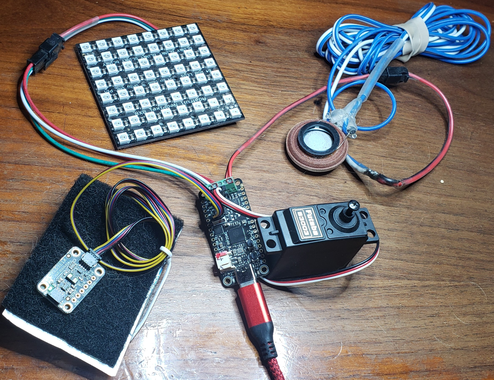
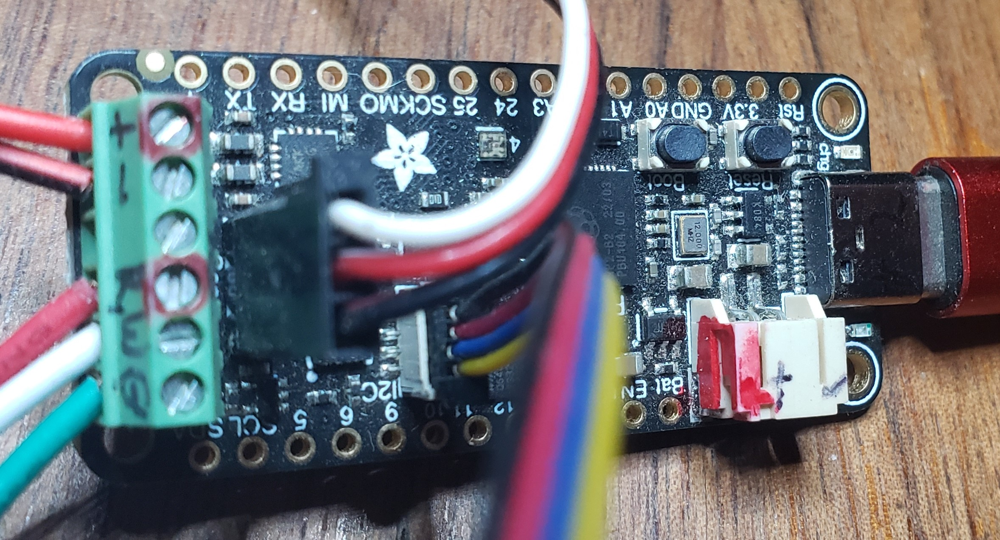

# DiscoBox™

[](https://vshymanskyy.github.io/StandWithUkraine)

## Introduction

This DiscoBox™ application aids postal workers' morale and may provide a minor
touch of enlightening joy to their day. It can easily be adapted to other
environments.

### For Users

To see what this application does, browse to
[https://YouTube.com/](https://YouTube.com/). In the future we'll put up a video
of the mailbox disco in action!

## What it does

The Prop-Maker Feather is mounted on the mailbox door and only has power while
the door is open. Opening the door starts the show; closing it ends it. All the
effects below run at the same time.

### Music

- A song starts about 0.1 s after power-up, before the lights and sensors are
  set up, so the carrier hears something straight away.
- Each power-up starts with the **next** song in the list, so the carrier gets
  a different song each day. The song number is kept in the board's `nvm`
  memory, which survives power-off.
- If the door stays open, the songs play one after another and loop back to the
  start.
- The playlist (`mp3files` in `config.py`, files in `/sounds/`):

  | Song | Length |
  | --- | --- |
  | `ClassicalGas_22k.mp3` | 90 s, fades out |
  | `happy_22k.mp3` | 12 s |
  | `Fire_22k.mp3` | 90 s, fades out |
  | `slow_22k.mp3` | 6 s |
  | `Africa_22k.mp3` | 90 s, fades out |
  | `OneDay_22k.mp3` | 90 s, fades out |

- Songs are 22050 Hz mono MP3s so they go through the audio mixer (song volume
  0.6), which lets effects such as the door creak play over them. A song in any
  other format still plays, but straight to the speaker, with no volume control
  and no effects over it. The full-length originals are in the separate
  `DiscoBox_References\sounds` folder.

### Cartoon door creak (`creak.py`)

- A raspy, buzzy synth tone plays over the song while the door swings, opening
  or closing.
- The accelerometer on the Feather sees the direction of gravity turn as the
  door swings. The faster it turns, the higher, raspier and louder the creak:

  | Door swing | Creak |
  | --- | --- |
  | under 20°/s (still) | silent |
  | 20°/s | 55 Hz, 12 clicks/s, quiet (volume 0.2) |
  | 200°/s or faster | 140 Hz, 35 clicks/s, loud (volume 0.9) |

- No calibration is needed; it works whichever way the board is mounted.
- The tuning numbers are at the top of `creak.py`. Turn the creak off with
  `door_creak = False` in `config.py`.
- Status: built, not yet tuned by ear on the real door.

### Lights (`lights.py`)

- The external 8x8 NeoPixel panel (64 LEDs, brightness 5%) runs a sequence of
  rainbow animations, changing every 5 seconds in random order:
  - **Rainbow** – the whole rainbow scrolls across the columns
  - **Rainbow comet** – a rainbow streak bounces back and forth
  - **Rainbow chase (columns)** – rainbow bands march across the panel
  - **Rainbow chase (pixels)** – small rainbow groups chase along every pixel
  - **Rainbow sparkle** – random pixels sparkle over a rainbow
- Purple and amber comets and a jade chase are also defined in `lights.py`, but
  are switched off in the sequence.
- The panel sits at the back of the box facing the door, so from outside it
  mostly reads as a shifting glow of colour.

### Servo (`prop_servo.py`)

- A servo on the servo header sweeps from 0° to 180° and back, 5° every 0.053 s
  (about 2 s each way). It can drive any small prop. (At 5° every 0.2 s the
  servo did not move, though the code was stepping it; cause unknown.)

### Sensors

- **Accelerometer (LIS3DH, on the Feather):** drives the door creak. In debug
  mode it also prints "Tapped!" and "Shaken!".
- **Distance sensor (VL53L1X):** measures up to about 1.3 m, about 10 times a
  second. For now the reading is only printed in debug mode; mail-in and
  mail-out effects are planned (see [IDEAS.md](IDEAS.md)).

### Arpeggiator mode (experimental)

- With `play_arpy = True` in `config.py`, the songs and creak are replaced by
  an 80s-style synth arpeggio (`arp_synth.py`, `arpy.py`) whose root note,
  tempo and pattern change at random, and the Feather's own LED changes colour
  with each note. This mode sends audio to the RX pin, not the speaker
  terminals, so it is for experimenting only.

### Settings (`config.py`)

| Setting | What it does |
| --- | --- |
| `production` | `True`: fast start, music first, no debug printing. `False`: play the start-up audio tests first and print debug information to the serial console. |
| `mp3files` | The playlist, in order. |
| `door_creak` | `True` to play the door creak. |
| `play_arpy` | `True` for the arpeggiator instead of songs. |

### Code layout

| File | Purpose |
| --- | --- |
| `main.py` | Starts the music, sets up the hardware, then runs the main loop |
| `config.py` | Settings |
| `sound.py` | Speaker output, mixer, playlist & start-up audio tests |
| `creak.py` | Door creak |
| `lights.py` | NeoPixel animations |
| `prop_servo.py` | Servo sweep |
| `sensors.py` | Distance sensor & accelerometer |
| `arp_synth.py`, `arpy.py` | Arpeggiator mode |
| `test_creak.py`, `test_distance.py`, `test_servo.py` | Test one part on its own (see below) |

### Testing one part at a time

Copy a test script to the board as `code.py`; CircuitPython runs `code.py`
instead of `main.py`. Each prints what it is doing to the serial console. Delete
`code.py` from the board to go back to the normal show.

| Script | What you should hear or see |
| --- | --- |
| `test_creak.py` | A beep, then pretend door swings, alternating the `creak.py` creak (1 beep first) with a higher, louder version (2 beeps first) |
| `test_distance.py` | A beep, the I2C addresses found (VL53L1X = `0x29`), then a tone that rises as your hand gets closer |
| `test_servo.py` | The servo moves to 0°, 90°, 180° and 90°, 2 s each, then sweeps |

Ideas for new effects, and what has been tried, are in [IDEAS.md](IDEAS.md).

### Installation




- Attach your devices to the PropMaker. What I did:

  - On the other end from the USB connector is a 6 screw green connector with
    the following labels on the bottom of the circuit board:
  - - & - go to a 4-8 ohm (Ω) speaker
  - Btn (button) is left disconnected
  - 5V, G & Neo (5 volt positive, Ground & NeoPixel data line) are connected to
    a LED panel.
  - Immediately in front of the 6 screw green connector is a standard 3 pin
    connector for the servo motor
  - move a little towards the USB connector and (near pin 10) is a small blond
    'Grove(?)' connector with can be attached to the ToF sensor (VL53L1X for me)
  - Finally plug in a USB cord from your computer to the device's USB C plug.
    With power the PropMaker should light up. If connected and with CIrcuit Pi
    installed, you should see a new drive' on your computer.

- Install Circuit Python onto your PropMaker if necessary. (It should arrive
  from the manufacturer with that preinstalled. If not, follow directions below
  for updating the library, or go to https://Adafruit.com or
  https://CircuitPython.org for the latest instructions.)

- Copy the `/lib/` and `/sounds/` directories, and all the `*.py` files
  (`main.py`, `config.py`, `sensors.py`, `lights.py`, `sound.py`,
  `prop_servo.py`, `creak.py`, `arp_synth.py` and `arpy.py`) from the same directory as you
  are reading this ReadMe.md file (https://github.com/vashjuan/DiscoBox/ most
  likely) to the root directory of the PropMaker.

- Check the settings in `config.py` (see [Settings](#settings-configpy) above).
  Leave `production = True` for the mailbox.

### Hardware

This is a Circuit Python script, derived from Adafruit's PropMaker example &
tutorial at: (https://learn.adafruit.com/adafruit-rp2040-prop-maker-feather)
with significant additions and restructuring.

It relies on (& tested with):

- https://www.adafruit.com/product/5768 - the Adafruit Prop Maker Feather

- an 8x8 Neopixel (or other) LED display

- A loudspeaker

- A Time of Flight sensor, in our case, a VL53L1X to measure distance to the
  incoming mail

- A generic servo motor, a Futaba 83003 for us

- Solar panel

- Solar panel charge controller with 3.7 volt 1500 mAh Lithium Ion battery

### Libraries

Circuit Python libraries included are from the base distribution listed in the
right column at
(https://circuitpython.org/board/adafruit_feather_rp2040_prop_maker/) We use a
few additional libraries, those are from the AdaFruit curated libraries at:
(https://circuitpython.org/libraries)

We don't use any of the additional libraries available in the Community Bundle:
(https://github.com/adafruit/CircuitPython_Community_Bundle/)


(https://github.com/adafruit/circuitpython)

(https://github.com/adafruit/circuitpython)

## Updating Circuit Python

The libraries in `/lib/` are from the CircuitPython **10.x** bundle, so the
PropMaker needs CircuitPython 10 (10.3.1 at last update). Update the firmware
before copying `/lib/` over. (Earlier code was tested with 9.2.1.)

To refresh the libraries, run [circup](https://github.com/adafruit/circup)
against this folder (it reads the version from `boot_out.txt`):

```powershell
pip install --upgrade circup
circup --path . update --all
```

1. Download the latest version of the \*.uf2 file from:
   [Feather RP2040 Prop-Maker Download](https://circuitpython.org/board/adafruit_feather_rp2040_prop_maker/)
   to a local location.
2. Enter Bootloader:

"To enter the bootloader, hold down the **BOOT/BOOTSEL** button (highlighted in
red above), and while continuing to hold it (don't let go!), press and release
the **reset button** (highlighted in blue above). **Continue to hold the
BOOT/BOOTSEL button until the `RPI-RP2` drive appears!**

If the drive does not appear, release all the buttons, and then repeat the
process above.

You can also start with your board unplugged from USB, press and hold the
BOOTSEL button (highlighted in red above), continue to hold it while plugging it
into USB, and wait for the drive to appear before releasing the button."

-- from https://learn.adafruit.com/adafruit-rp2040-prop-maker-feather?view=all

3. Update the PropMaker's library

Then drag the .UF2 file you downloaded onto the `RPI-RP2` drive -- _not_ named
Circuit Python at this point!

A few seconds after the new `*.uf2` file is copied to the `RPI-RP2` drive, the
new file is automatically installed and the drive will disappear & then show up
as `CIRCUITPY` again.

You're done! This should have updated the files in the `lib` folder, but not
have touched any other folders or files on the PropMaker.

### 3rd party libraries

We do not currently use any.


### Color Options

- Colors defined by Adafruit Led Animation library: Amber, Aqua, Blue, Cyan,
  Gold, Green, Jade, Magenta, Old lace, Orange, Pink, Purple, Red, Teal, White,
  Yellow, Old lace (= warm white), Black, or off.

- RAINBOW is a list of colors to use for cycling through - includes, in order:
  red, orange, yellow, green, blue, and purple.

- RGBW_WHITE_RGB is for RGBW strips to illuminate only the RGB diodes

- RGBW_WHITE_RGBW is for RGBW strips to illuminate the RGB and White diodes

- RGBW_WHITE_W is for RGBW strips to illuminate only White diode

### A Note on batteries

"The JST connector polarity is matched to Adafruit LiPoly batteries. Using wrong
polarity batteries can destroy your Feather. Many customers try to save money by
purchasing Lipoly batteries from Amazon only to find that they plug them in and
the Feather is destroyed!""

### Public Feedback & Contribution

We encourage your feedback and contributions to this repository. Content
suggestions and discussions (specific to DiscoBox) can be communicated in the
following ways:

- GitHub “issues.” Each issue is a conversation about specific project work
  initiated by a member of the public.
- GitHub "discussions". Each discussion is a project communication forum.
  Discussions are not specific to elements of work like a pull request. We
  encourage you to browse and join in on discussions or start a new conversation
  by creating a new discussion.
- Direct changes and line edits to the content may be submitted through a "pull
  request" by clicking "Edit this page" on any site page in the repository. You
  do not need to install any software to suggest a change. You can use GitHub's
  in-browser editor to edit files and submit a pull request for your changes to
  be merged into the document. Directions on how to submit a pull request can be
  found on GitHub.
- Send your content suggestions or proposed revisions to the DiscoBox team via
  email to disco@vashondesign.com

### Testimonials

> _"Huh!"_
>
> -- local mail carrier Craig on Vashon Island, WA

## License & Copyright

©2023 John Cornelison, under the MIT License

Details at
[GitHub - VashJuan/DiscoBox: Delight your postal delivery person&#39;s day with a fun mailbox experience! Powered by CircuitPython](https://github.com/vashjuan/DiscoBox)
